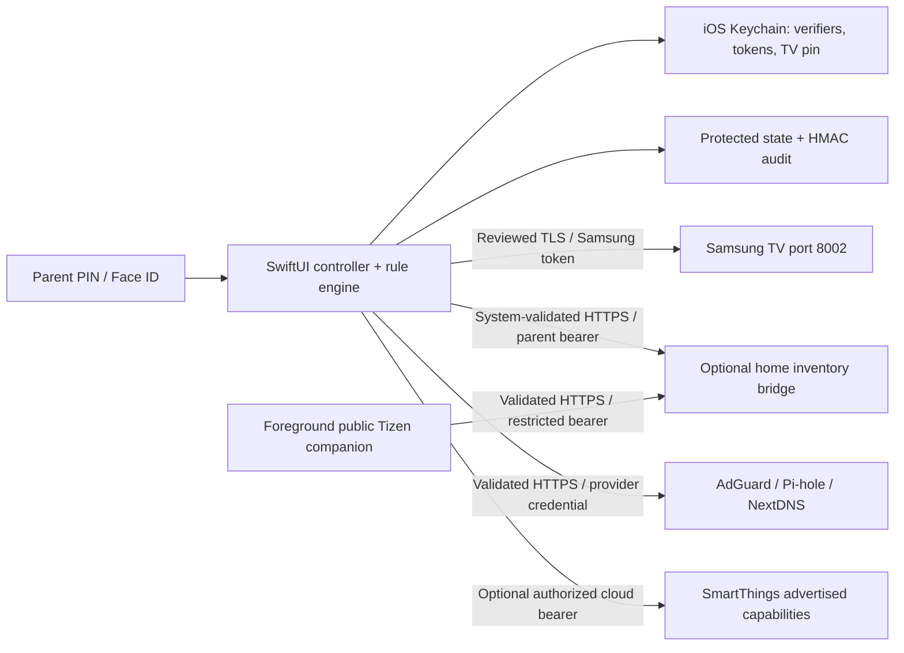

# Security architecture and boundaries

## Authentication and least privilege

The parent PIN is 6–12 digits, salted with 32 random bytes and derived with
600,000 PBKDF2-HMAC-SHA256 iterations into a 32-byte verifier. Comparisons avoid
early byte exit. Verifiers, retry counters, exponential lockout deadlines, token
secrets and certificate pins are in `WhenUnlockedThisDeviceOnly` Keychain items.
After five failed PIN attempts the persisted delay grows from 30 seconds to a
maximum of 15 minutes. This does not make a numeric PIN immune to a compromised
OS or an attacker who can read Keychain items; keep the iPhone secure.

Face ID is optional after PIN enrollment. A saved biometric-domain state must
match the current enrollment; changes require parent PIN re-authentication.
An authentication operation finishing after background locking cannot reopen
the session. Sensitive views are covered while inactive; management operations
are cancelled/disconnected on background lock. Session inactivity is five minutes.

No TV PIN is read/stored or sent. There are no hardcoded passwords/tokens.
Child profiles and age thresholds are local parent settings, not child OS accounts.
The gate protects controller access, not Samsung menus or other launch clients.

## Network trust

Only private IPv4/Tailscale-range TV addresses are accepted. The TV client uses
TLS 1.2+ on port 8002 and explicitly reviewed SHA-256 leaf-certificate pinning.
It rejects changed certificates, cross-host redirects and previously observed
device identities that change/disappear. First-use trust still depends on a
trusted network and correctly identifying the TV. A shared factory certificate
does not independently identify one physical TV. The Samsung protocol is not a
publicly guaranteed security contract; check token enforcement on the real TV.

TV tokens are sent only in the encrypted Samsung handshake query because that
is the observed protocol; they are never logged. No plaintext control fallback
exists. The REST status/close contract may have different authorization behavior
on the device: pinning protects the channel, not the TV from other LAN clients.

Bridge, SmartThings and DNS requests use system certificate validation, with no
global trust override. No credential is intentionally put into their URL queries.
Redirects are refused. Secrets are not written into state JSON, cloud config,
companion browser storage, source files or audit export.
Bridge and DNS Keychain accounts are scoped to the normalized HTTPS origin and
provider account/profile, so changing a URL cannot silently reuse another
server's saved credential. The fixed SmartThings API origin is not user-editable.

The bridge uses separate high-entropy parent/companion bearer tokens and stores
only their hashes. One-use pairing codes expire after 120 seconds and have per-IP
and global attempt limits. Companion tokens expire within eight hours, cannot
use parent endpoints and can revoke only themselves. The bridge never trusts
proxy IP headers. Deploy directly on the private network/VPN as documented;
there is no assumed reverse-proxy trust configuration.

## Safe operations and observability

The operation coordinator records an intent before sending mutating requests.
Close, power-off, provider changes, pairing removal and session revocation have
explicit UI review/confirmation. Requests are not replayed after a disconnect.
A submitted command, provider acknowledgement and observed TV state are distinct
outcomes. Unrecognized responses fail rather than producing fabricated success.

Snapshot sizes, entry counts, IDs and allowed fields are validated. Unknown
bridge management routes do not exist. Public Tizen API permission errors are
reported without adding privileges. The companion uses DOM `textContent`, a
restricted CSP and explicit outgoing access origin. Its only persisted data is
at the home bridge; credentials remain in memory on the TV.

Protected app files are atomically written and excluded from backup. Audit data
is HMAC chained, with an independent Keychain key, and verified on load. Failure
locks management instead of discarding the log. Retention is 5,000 entries with
a chain anchor. An attacker able to delete/roll back the entire file is outside
that integrity guarantee; no remote append-only witness exists. Exports contain
app IDs and parent activity and should be shared deliberately.

## Residual limits

- Physical TV control, factory reset, alternate networks, casting/HDMI and router
  administrator access can bypass phone rules and some native controls.
- An ordinary Tizen app cannot stop other launch paths or keep itself running.
  Stale heartbeats are diagnostics, not successful enforcement.
- DNS blocks cannot promise app blocking or encrypted/offline-content control.
- Local app-data erasure removes rules. There is no administrator recovery server
  or unauthenticated reset flow. Reinstall/keychain/account migration needs care.
- No dependency is required by the production bridge; optional QA dependencies
  are not shipped in the app. Do not package secret/config/QA working directories.
- Xcode compilation, 26 simulator unit tests and 2 interface regressions passed
  on the cloud Mac. The user installed v0.1.0. Deployment of real service
  certificates and v0.1.1 phone/TV management validation remain pending.
  This document describes implementation, not a completed independent
  security audit or certification.
